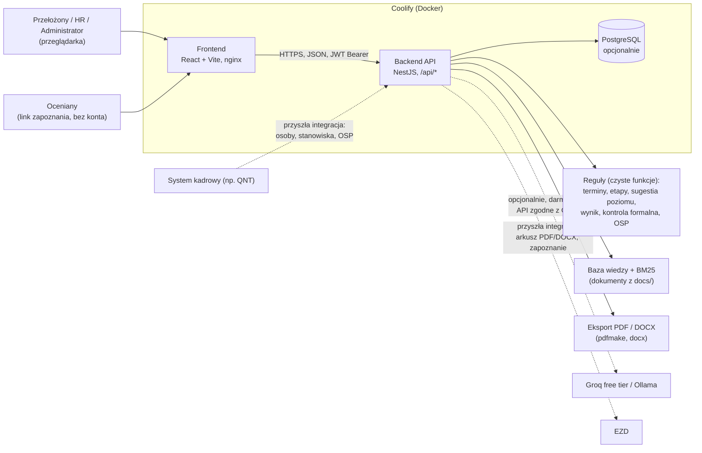

# Kompas Kompetencji – architektura i technologie

## Schemat

## Technologie

| Warstwa       | Technologie                                                                                       |
| ------------- | ------------------------------------------------------------------------------------------------- |
| Frontend      | React 19, TypeScript, Vite, React Router, TanStack Query, własny design system (`docs/DESIGN.md`) |
| Backend       | Node.js, NestJS 12, TypeScript, walidacja zod, `@nestjs/authentication` / `@nestjs/authorization` |
| Dane          | dane demo w pamięci; PostgreSQL przez Drizzle ORM z migracjami przy starcie (dziennik przełożonego) |
| Dokumenty     | pdfmake (PDF, osadzona czcionka Tinos, OFL), docx (DOCX); obie biblioteki MIT                      |
| AI            | własny BM25; opcjonalnie dowolny LLM przez API zgodne z OpenAI (Groq free tier, Ollama)           |
| Jakość        | Vitest (testy jednostkowe i e2e, ok. 300), supertest, oxlint, prettier, ewaluacja asystenta        |
| Wdrożenie     | Docker (obrazy frontendu i backendu, `HEALTHCHECK`), Coolify z autodeployem z gałęzi `main`       |

Bez płatnych usług i bez komercyjnych licencji.

## Moduły backendu (`src/`)

| Moduł                                | Za co odpowiada                                                                 |
| ------------------------------------ | ------------------------------------------------------------------------------- |
| `auth`, `admin`                      | logowanie, JWT, konta i role (`UsersRepository`)                                |
| `cases`                              | teczki ocen, etapy, terminy, akcje (maszyna stanów), kontrola formalna         |
| `competency-model`, `sheets`, `civil-service-grades` | model kompetencji, arkusze A/B/C/pierwszej oceny, stopnie służbowe |
| `assessments`                        | sugerowany poziom i wynik oceny                                                 |
| `osp`                                | opisy stanowisk i ich analiza (arkusz, kryteria dodatkowe)                      |
| `people`, `journal`                  | profil pracownika, dziennik notatek i obserwacji przełożonego                   |
| `hr`                                 | monitoring i przypomnienia                                                       |
| `export`                             | arkusz PDF/DOCX                                                                  |
| `ack`                                | publiczny link zapoznania ocenianego i sprzeciw                                  |
| `assistant`, `docs`                  | asystent AI, baza wiedzy, udostępnianie dokumentów źródłowych                   |
| `demo`, `health`, `config`           | reset danych demo, healthcheck, konfiguracja dla frontendu                      |

**Reguły jako czyste funkcje.** Logika merytoryczna jest oddzielona od frameworka w plikach `*.rules.ts` (np.
`src/cases/deadlines.rules.ts`, `stages.rules.ts`, `actions.rules.ts`, `formal-check.rules.ts`,
`src/assessments/suggest-level.rules.ts`, `evaluate.rules.ts`, `src/osp/osp-analysis.rules.ts`). Każda ma testy
jednostkowe i zwraca podstawę prawną. Zmiana przepisu to zmiana jednej funkcji i jej testu. Model kompetencji jest
generowany z pliku XLSX, więc inny urząd może podmienić dane bez zmian w kodzie.

## API

REST/JSON pod `/api`, opisane w [README backendu](../../README.md) (tabele tras, reguły walidacji, kody błędów).
Wejście walidują schematy zod (`src/**/*.schemas.ts`); błędy 400 mają komunikaty po polsku, niedozwolone przejścia
etapów 409 z wyjaśnieniem. Specyfikacja OpenAPI jest w planie.

## Uwierzytelnianie i role

- Logowanie loginem i hasłem (`POST /api/auth/login`), hasła jako skróty scrypt, token JWT HS256 ważny 8 h.
- Każda trasa `/api/*` wymaga tokenu, poza health, config, logowaniem, publicznymi dokumentami prawnymi i linkiem
  zapoznania (który ma własny losowy token 32 B, ważny 14 dni).
- Role: `SUPERVISOR` (własne teczki i własny zespół), `HR` (wszystkie teczki do odczytu, monitoring, przypomnienia),
  `ADMIN` (konta i role). Rola jest czytana z konta przy każdym żądaniu, nie z tokenu, więc zmiana roli działa od
  razu. Dostęp do teczki sprawdza polityka `src/auth/case.policy.ts` (cudza teczka: 403/404).

## Ochrona danych

- Wszystkie dane w demo są fikcyjne.
- Dziennik przełożonego (notatki, obserwacje) widzi tylko jego autor; HR i administrator dostają 403.
- Link zapoznania pokazuje tylko to, co drukuje arkusz (bez obserwacji, ocen wskaźników, OSP, historii).
- Do modelu językowego nie trafiają imiona ani nazwiska; historia czatu nie jest zapisywana ani logowana.
- Profil pracownika zwraca tylko dane potrzebne do oceny (stanowisko, komórka, rodzaj zatrudnienia, historia ocen).

## Wdrożenie

Dwa obrazy Docker (frontend: build Vite + nginx; backend: Node.js) uruchomione w Coolify. Każdy push na `main` buduje
i wdraża nową wersję. Konfiguracja przez zmienne środowiskowe (`.env.example`): `FRONTEND_URL` (CORS), `JWT_SECRET`,
`DATABASE_URL`, `LLM_*`, `DEMO_TODAY`. Lokalnie: `docker compose up -d db` dla PostgreSQL, `npm run start:dev`.

## Gotowość do integracji

- **System kadrowy (np. QNT)** jako źródło osób, stanowisk i OSP: konta są za interfejsem `UsersRepository`
  (`src/auth/users.repository.ts`, dziś implementacja w pamięci), a dane pracownika za API People
  (`GET/PATCH /api/people/:personId`). Implementacja repozytorium czytająca z QNT zastępuje seed bez zmian w regułach.
- **EZD** jako odbiorca dokumentów: arkusz jest dostępny jako plik (`GET /api/cases/:id/sheet.pdf|docx`), a
  potwierdzenie zapoznania i sprzeciw są zdarzeniami z datą w historii teczki (`/api/ack/:token`). Przekazanie do
  EZD to wywołanie jego API po podpisie i po zapoznaniu.
- Przypomnienia HR (`POST /api/hr/reminders`) są dziś symulowane; docelowo e-mail lub EZD.

## Do zabezpieczenia przed wdrożeniem produkcyjnym

- SSO urzędu (np. Active Directory / OIDC) zamiast haseł w aplikacji.
- `JWT_SECRET` i klucze API w sejfie sekretów, rotacja.
- Limit zapytań (rate-limit) na logowaniu i asystencie.
- Nagłówki bezpieczeństwa (np. helmet), Content Security Policy.
- Log audytowy: kto i kiedy czytał lub zmieniał teczkę.
- Trwała baza danych dla teczek (dziś w pamięci; PostgreSQL ma tylko dziennik), kopie zapasowe, retencja.
- Wyłączenie resetu demo (`POST /api/demo/reset`) i kont demo (`VITE_DEMO_ACCOUNTS=false`).
- Model językowy uruchomiony w infrastrukturze urzędu (Ollama/vLLM), żeby dane spraw nie wychodziły poza urząd.
- Rejestr czynności przetwarzania i ocena skutków dla ochrony danych (RODO).
